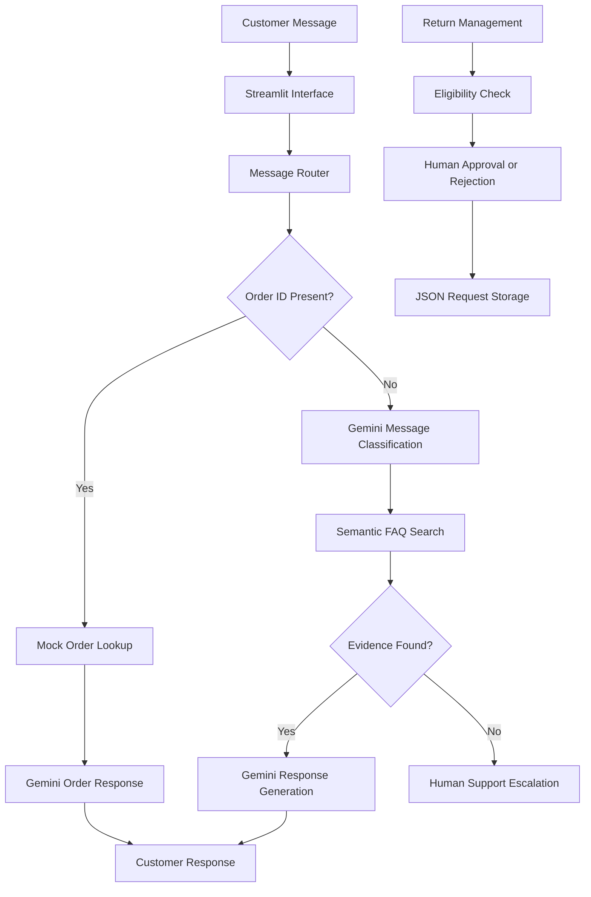

# SupportPilot AI – Customer Support and Operations Agent
🚀 **Live Demo:** [Try SupportPilot AI](https://supportpilot-ai-xzbuw4wpkgrcd6swtnmpio.streamlit.app/)

**GitHub Repository:** [SupportPilot AI](https://github.com/lakshmi26-u/supportpilot-ai)
An AI-powered customer support assistant built with Python, Streamlit, Google Gemini, Sentence Transformers, and ChromaDB.

## Features
- Customer message classification: shipping, returns, payment, product, and other.
- Semantic FAQ retrieval using Sentence Transformers and ChromaDB.
- Gemini-generated responses grounded in retrieved FAQ evidence.
- Mock order lookup and shipping-status assistance.
- Return eligibility checking and request management.
- Human approval workflow for return requests.
- Escalation when sufficient evidence is unavailable.
- Privacy-conscious event logging.
- Automated backend testing.

## Technology Stack
| Technology | Purpose |
|---|---|
| Python | Backend development |
| Streamlit | User interface |
| Google Gemini | Classification and response generation |
| Sentence Transformers | Text embeddings |
| ChromaDB | Vector database |
| Pandas | Data handling |
| Pytest | Automated testing |

## Installation

1. Clone your GitHub repository.
2. Create and activate a Python virtual environment.
3. Install dependencies using `pip install -r requirements.txt`.
4. Set the `GEMINI_API_KEY` environment variable.
5. Start the application using `streamlit run app.py`.

## Automated Tests

Run `python -m pytest tests/test_backend.py -v` from the project root.

**Latest test result: 32 tests passed.**

Tests cover order lookup, return eligibility, approval workflows, message classification, FAQ retrieval, response generation, routing, and error handling.

## Evaluation

- Total test cases: 10
- Evidence-supported questions: 8
- Unsupported questions escalated: 2
- Response routing success: 100%

The routing result measures response and escalation path selection, not guaranteed factual accuracy.

## Safety and Limitations

- Uses mock order data, not a live commerce platform.
- Return requests require human approval.
- AI responses are designed to use retrieved FAQ evidence.
- Customer messages and relevant order information may be sent to Google's Gemini API.
- Return requests use local JSON storage, suitable for a demonstration but not concurrent production use.
- Reviewer names are not authenticated in this demo.
- Production use requires secure authentication, access control, a transactional database, monitoring, and privacy review.

## Future Improvements

- Secure database integration.
- Authenticated support-agent accounts.
- Improved retrieval and answer-quality evaluation.
- More end-to-end tests.
- Approved external order-management integrations.

## Project Purpose

A practical portfolio project exploring Generative AI, RAG, semantic search, human-in-the-loop workflows, and automated testing in a customer support application.

## Architecture



## Project Structure

```text
customer-support-operations-agent/
├── app.py
├── app_backup.py
├── requirements.txt
├── .env.example
├── .gitignore
├── src/
│   ├── __init__.py
│   └── backend.py
├── data/
│   ├── faqs.json
│   └── mock_orders.csv
├── tests/
│   └── test_backend.py
├── evaluation/
│   ├── evaluation_dataset.json
│   └── results/
└── docs/
```

Generated vector database files and runtime return-request records are excluded from Git.

## Detailed Setup

### 1. Clone the repository

```bash
git clone YOUR_GITHUB_REPOSITORY_URL
cd customer-support-operations-agent
```

Replace the placeholder URL with your repository URL.

### 2. Create a virtual environment

```bash
python -m venv venv
```

Windows:
```bash
venv\Scripts\activate
```

macOS/Linux:
```bash
source venv/bin/activate
```

### 3. Install dependencies

```bash
pip install -r requirements.txt
```

### 4. Configure Gemini API access

Set the GEMINI_API_KEY environment variable before starting the application.

Windows PowerShell:
```powershell
$env:GEMINI_API_KEY="your_gemini_api_key"
```

macOS/Linux:
```bash
export GEMINI_API_KEY="your_gemini_api_key"
```

The .env.example file documents the variable but the current application does not automatically load a .env file.
Never commit your actual API key.

### 5. Launch the application

```bash
streamlit run app.py
```


